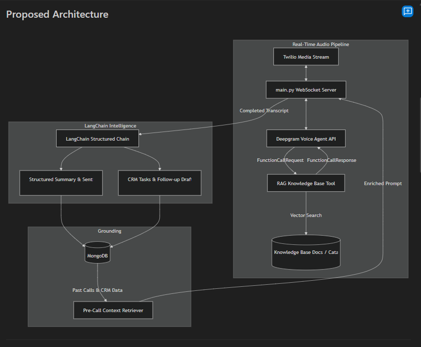

# Whitespace CRM - Voice AI Agent with LangChain & RAG

An intelligent, real-time voice calling assistant powered by **Deepgram Speech-to-Speech (STS)**, **LangChain**, and **Retrieval-Augmented Generation (RAG)** for healthcare and pharmacy customer relationship management.

---

## Key Capabilities

1. **In-Call Real-Time RAG (Deepgram Tool Calling)**:
   - Callers can ask questions about medications, dosages, indications, side effects, prices, delivery options, return policies, and FAQs.
   - Deepgram triggers a `FunctionCallRequest` which queries the local sub-50ms hybrid vector knowledge base (`functions.rag.knowledge_base`).
   - The result is immediately returned as a `FunctionCallResponse` and spoken naturally to the caller.

2. **Pre-Call Dynamic Context Retrieval**:
   - Before the audio connection is established, the agent queries MongoDB (`uploaddetails` and `calls` collections) for customer history and recent call summaries via `functions.rag.customer_context`.
   - The agent's dynamic prompt is grounded in the customer's specific background and previous interactions.

3. **Post-Call LangChain Intelligence Pipeline**:
   - Transcripts are parsed with LangChain structured output chains (`functions.rag.post_call_chain`).
   - Automatically extracts:
     - **Executive Summary**
     - **Sentiment Rating & Rationale**
     - **Actionable Follow-up Tasks** (auto-inserted into the CRM `taskdetails` collection)
     - **Draft Customer Follow-Up Message** (SMS/Email)

4. **Phone Audio Stream Integration**:
   - Bi-directional audio over WebSockets between Twilio Media Streams and Deepgram Nova-3 + GPT-4o-mini + Aura-2 TTS.

---

## Directory Structure

```text
agent/
├── main.py                          # WebSocket server & Twilio/Deepgram pipeline
├── config.json                      # Deepgram agent settings & tool specifications
├── functions/
│   ├── rag/
│   │   ├── knowledge_base.py        # Vector & keyword hybrid search engine (<50ms)
│   │   ├── customer_context.py      # Pre-call CRM & call history retriever
│   │   ├── tools.py                 # Deepgram function calling execution router
│   │   ├── post_call_chain.py       # LangChain structured summary & task generator
│   │   └── data/
│   │       └── default_knowledge.json # Pharmacy catalog, medications, and policies
│   ├── transcript/
│   │   ├── model.py                 # MongoDB transcript saving & processing
│   │   ├── sentiment.py             # Hugging Face sentiment & summary fallbacks
│   │   └── transcript_code.py       # Live session turn-based transcript tracker
│   └── testing/
│       └── pharmacy_functions.py    # Order management and legacy catalog
```

---

## Setup & Running

### 1. Environment Variables (`.env`)
```env
DEEPGRAM_API_KEY="your_deepgram_key"
MONGODB_URI="mongodb+srv://..."
MONGODB_DB="whitespace-crm"
HUGGINGFACEHUB_API_TOKEN="your_hf_token"

# Optional: Add OpenAI or Gemini keys for enhanced LLM extraction
OPENAI_API_KEY=""
GEMINI_API_KEY=""

AGENT_HOST="0.0.0.0"
AGENT_PORT=5000
```

### 2. Install Dependencies
```bash
pip install -r requirements.txt
```

### 3. Run Integration Tests
```bash
python test_rag_integration.py
```

### 4. Start Voice Agent Server
```bash
python main.py
```
Server will be available on `ws://0.0.0.0:5000` waiting for Twilio voice media streams.
